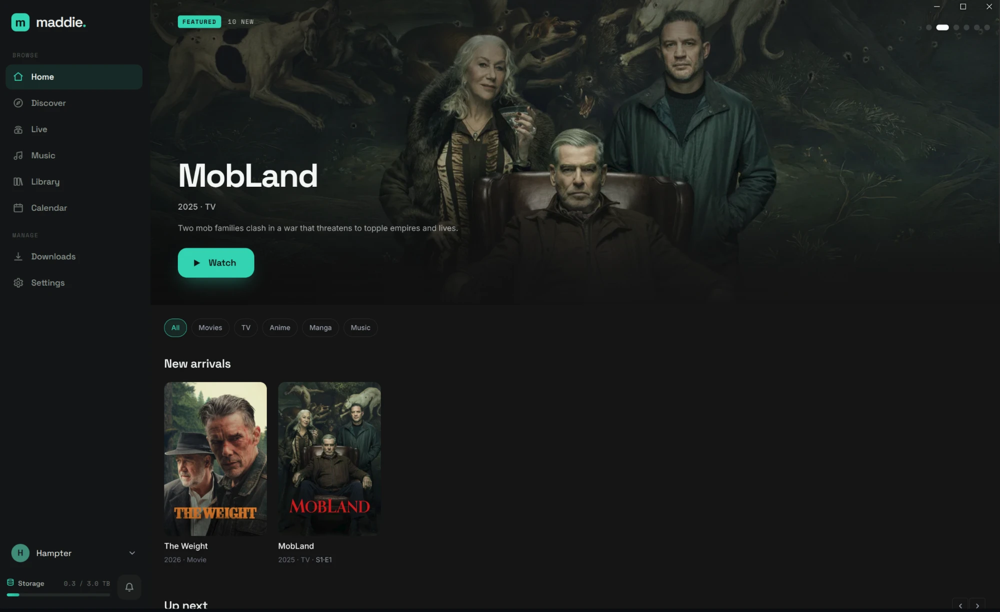
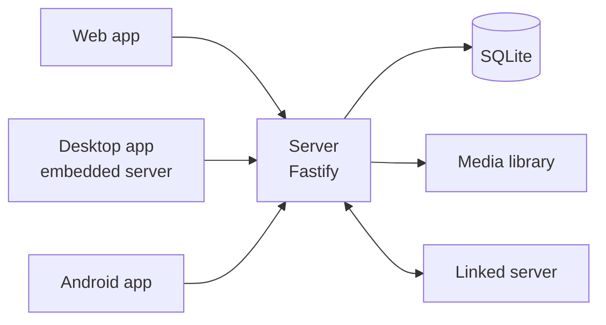
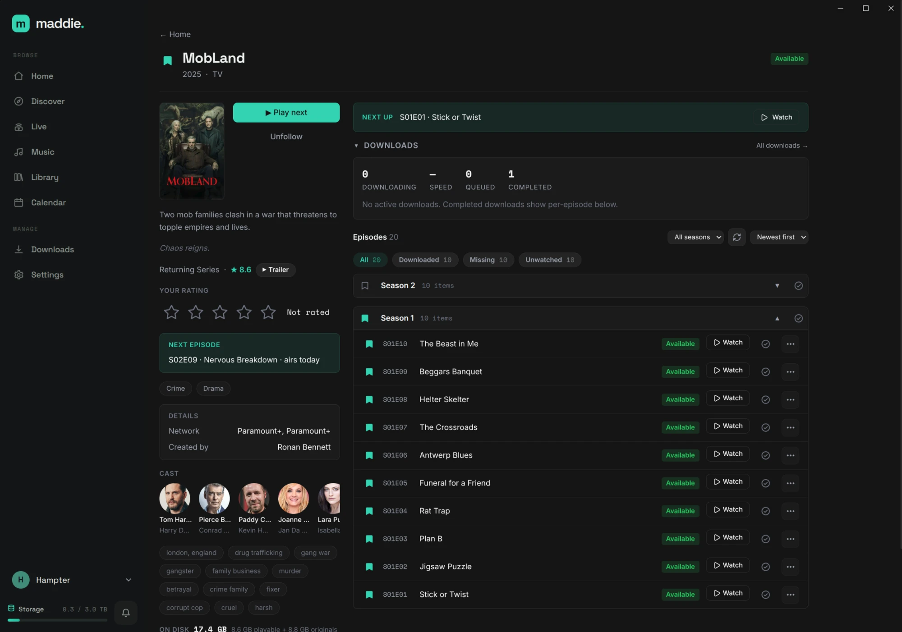
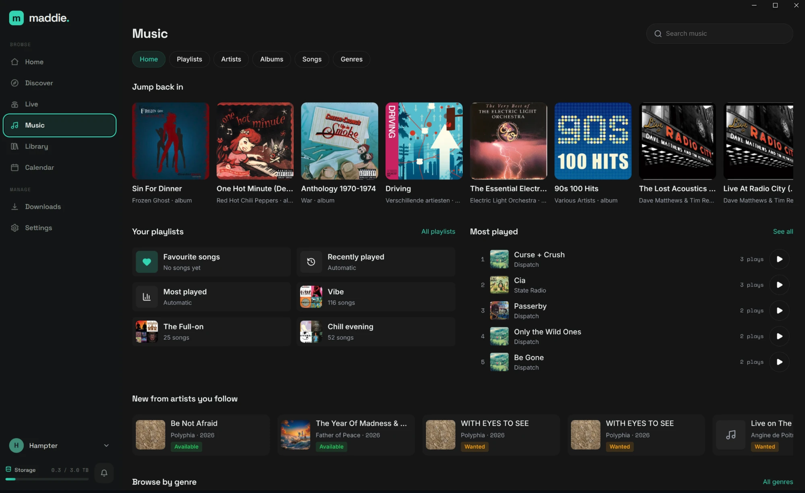
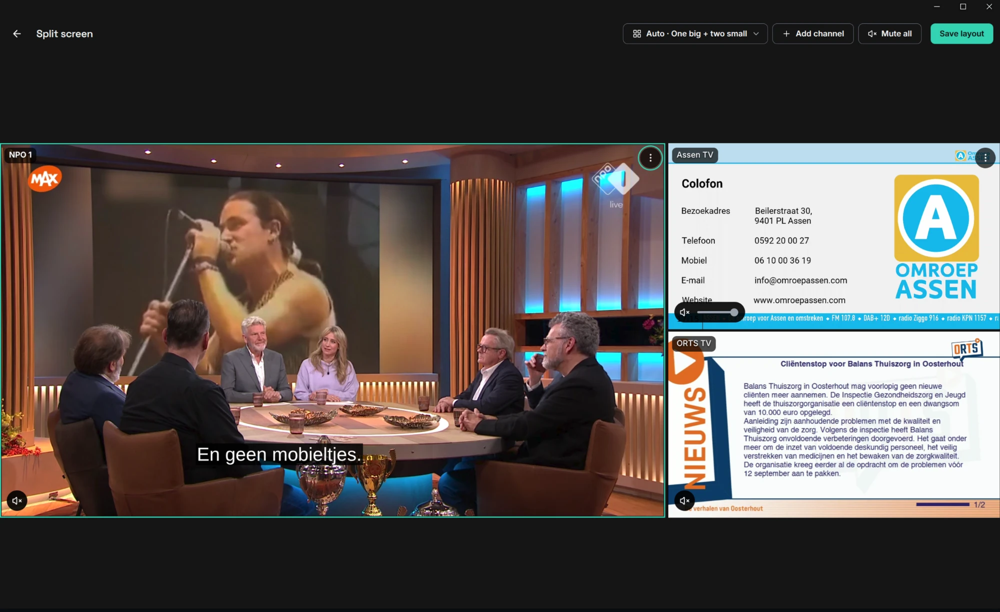

# Maddie

Maddie is a self-hosted media manager for a household: one application to find, track, download and watch movies, TV, anime, manga and music.

## What it does

- Discover titles and see at a glance what is already in the library, with metadata and artwork from public catalogues such as TMDB, AniList and MusicBrainz.
- Follow a series, a manga or a single song; new episodes, chapters and tracks are picked up automatically against a chosen quality profile, with a calendar of upcoming releases.
- Play video in the browser with subtitles, read manga in a built-in reader, and play music with a queue that survives a reload.
- Use one device as a remote control for playback on another, paired by QR code.
- Keep separate profiles per household member ("Who's watching?"), each with its own progress, ratings and library, and link two households' servers so each can watch and listen on the other's.

## How it is built

A TypeScript monorepo (pnpm workspaces, strict mode throughout).

- **Server:** Node.js and Fastify, serving a REST and WebSocket API, a job scheduler, an embedded download engine and ffmpeg-based transcoding with HLS streaming.
- **Storage:** SQLite through Drizzle ORM, with migrations; media files in a configurable library folder.
- **Web client:** a React single-page app built with Vite.
- **Desktop:** an Electron app that runs the server in-process.
- **Android:** a Capacitor app that either connects to a server or runs a standalone on-device engine over shared core packages.
- **Delivery:** a Docker image and a Helm chart, versioned and released from CI.

## Screenshots

## Status

In active development and in use on a self-hosted install. Runs in the browser, as a desktop app and on Android.
